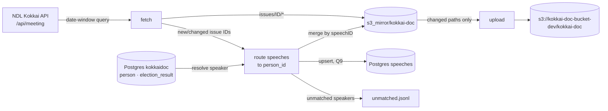

# Speech auto-update

**Status:** planned · **Owner:** kenchan · **Created:** 2026-10-13

> Picking this up in a new session? Start with [PROGRESS.md](PROGRESS.md) — current state, environment facts and next steps.

Keep the Diet speech data current without manual runs. A scheduled job pulls newly published meeting records from the NDL Kokkai API, folds them into the API-served datasets, and pushes only the changed files to the S3 data lake.

Related guides: [DATA-PIPELINES.md](../../docs/agents/DATA-PIPELINES.md), [DATA-LAYOUT.md](../../docs/agents/DATA-LAYOUT.md), [INFRA.md](../../docs/agents/INFRA.md)

---

## 1. Why

- The speech data in S3 was last written around **2025-12-28** (S3 `LastModified` on `issues/` and `repr_speeches_id_organized/`), so it's about 10 months out of date.
- Today's updates are manual and spread across three scripts plus a hand-run `s3 sync`:
  `collect_all_speeches.py` → `reorganize_all_repr_speeches.py` → upload.
- Those scripts are written for a one-off full crawl, not incremental updates:
  - `collect_all_speeches.py` crawls **by speaker name** (resuming from `logs/speech_progress.txt`) or by full-text `any=` search. It has no date window, so it can't ask "what's new since last time?"
  - `get_and_save_issue()` **skips any issue that already has a directory**. NDL corrections to a meeting record are never picked up.
  - It requests `maximumRecords=10` and never pages. That's fine when fetching a single `issueID`, but unsafe for date-range queries.
  - Module-level code raises on purpose (`raise Exception("ANY_TEXTS is not empty")`) as a manual control-flow switch. It can't run unattended.
  - `reorganize_all_repr_speeches.py` re-walks **every** issue directory and needs a local Postgres for speaker → `person_id` mapping.

## 2. Goals

1. A single command (`./scripts/update-speeches.sh`) that is **incremental, idempotent and resumable**. Running it twice in a row does nothing the second time.
2. Runs on a schedule with no human input. If it fails, a re-run fixes things.
3. Updates the datasets the backend serves for speeches, and also keeps the Postgres `speeches` table current (Q9, after the repair in §4.10):

   | S3 prefix (`kokkai-doc/…`) | Backend use | Updated how |
   |---|---|---|
   | `issues/{issueID}/meta.json`, `speeches.jsonl` | `GET /speeches/get_issue_by_id` | Written per new or changed meeting |
   | `repr_speeches_id_organized/{person_id}/all_speeches.jsonl` | `/speeches/get`, `/available`, `/get_first_page_of_all_topics` | New speeches merged in by `speechID` |
   | `repr_speeches_id_organized/{person_id}/{Topic}.jsonl` | same | Same merge, filtered by `resource/experiment_config.json` search words |

4. Uploads only the files that changed. It never deletes anything in S3.
5. Works on this Mac as it is today: `s3_mirror/` (full copy of the bucket) plus the local Postgres `kokkaidoc` restored from the old machine on 2026-10-13. There is no `data/data/`.

## 3. Non-goals (this phase)

- `relevance_and_productivity/aggregate_processed.jsonl`. It comes from manual NDL TSV exports (`process_relevance_data.py`) and stays manual.
- Downstream LLM outputs (`idea_summaries/`, stance axes, `ideology/`). Refreshing those costs money and needs review, so it's a separate spec.
- Vote records, representative lists, election history.
- Moving the job to AWS. See [§9 Phase 3](#9-rollout).

## 4. Design

### 4.1 Overview



The job has three stages: **fetch**, **route**, **upload**. Each stage writes its output to a state file before the next one starts, so a crash in any stage can be resumed.

### 4.2 Working copy

The job reads and writes `s3_mirror/kokkai-doc/` directly. That's the only full copy on this machine, and it's what the local backend reads. `data/data/data_all_speeches/` is not used.

> Decided (Q1): work directly in `s3_mirror/`. Keeping `data/data/` as the canonical copy, as DATA-LAYOUT.md describes, would be the cleaner model, but this machine has no `data/data/`, so it would need a full rebuild first.

### 4.3 Fetch: finding new and changed meetings

Use the NDL **meeting** endpoint with a date window rather than crawling by speaker:

```
https://kokkai.ndl.go.jp/api/meeting?from=YYYY-MM-DD&until=YYYY-MM-DD&recordPacking=json&maximumRecords=10&startRecord=N
```

- Page through `nextRecordPosition` until it's empty. The meeting endpoint returns at most 10 meetings per page, including full `speechRecord` text.
- **Window:** `from = last_successful_run − LOOKBACK_DAYS`, `until = today`. NDL publishes minutes days to weeks after the meeting date and sometimes corrects them later, so each run re-scans the lookback window. The default is `LOOKBACK_DAYS = 60`.
- **Change detection** for an issue that already exists: compare speech count, the set of `speechID`s, and the max `updateTime` with what's on disk. Rewrite `meta.json` and `speeches.jsonl` only if something differs. Unchanged issues produce no writes and no uploads.
- **Rate limits:** one request at a time with ≥ 3 s between requests (the old scripts used 5 s; NDL asks clients not to send requests in parallel). Retry with backoff on HTTP 5xx, timeouts and invalid JSON, giving up after 5 tries per page.
- Writes are atomic: write to `*.tmp`, then `os.replace`.
- Output: `state/changed_issues.json` lists the issue IDs written in this run.

**First run / backfill:** with no state file, `from` defaults to the latest `meta.date` found in `s3_mirror/kokkai-doc/issues/` minus `LOOKBACK_DAYS`. That covers the gap since December 2025. The CLI also accepts `--from` to force a wider window.

### 4.4 Route: merging speeches into per-politician files

For every speech in `changed_issues`:

1. **Resolve `speaker` → `person_id`** through Postgres (see 4.5). Skip procedural speakers such as the chair, `会議録情報` and empty speakers, as the current script does.
2. **Topic tags**: reuse `identify_topic_for_speech()` (search-word matching from `resource/experiment_config.json`). Move it into a shared module instead of copying it.
3. **Merge** into `repr_speeches_id_organized/{person_id}/all_speeches.jsonl` and each matching `{Topic}.jsonl`:
   - Each line has the same shape as today: the NDL speech record plus `"meta": <issue meta.json>`.
   - Key is `speechID`. Existing IDs are **replaced** (so corrections show up) and new IDs are added.
   - **Ordering:** existing files are roughly newest-first, and the backend paginates in file order, so merged files are re-sorted by `(meta.date desc, issueID desc, speechOrder asc)`.
   - Rewrite the whole file atomically (tmp + rename). The largest files are a few MB, so a full rewrite is cheap.
4. Speakers that can't be resolved are appended to `state/unmatched_speakers.jsonl` with name, yomi, group, date and issueID, then skipped. They are **not** guessed.
5. Output: `state/changed_paths.txt` lists every file written in this run.

### 4.5 Speaker → person_id resolution (Postgres)

Resolution uses the local Postgres `kokkaidoc` (`localhost:5432`, user `postgres`, password `PSQL_DATABASE_PASSWORD` from `data/.env`), the same DB and connection settings as the existing scripts. It was restored on 2026-10-13 and checked: 4,818 people, 22,576 election results, `pg_trgm` installed, and every `person_id` in S3 `repr_speeches_id_organized/` and `electionHistory/` exists in `person`.

**Lookup order**, wrapped in a `SpeakerResolver` with a per-run cache keyed by `(speaker, speakerYomi, speakerGroup)`:

1. `get_politician_id_by_name(cur, speaker, speakerYomi, speakerGroup, stop_for_input=False)`, reused unchanged. It finds a single match on cleaned kanji name, or failing that a single match on kana. It returns `None` when there are several candidates or none, and **never prompts** with `stop_for_input=False`.
2. **Same-name disambiguation** (new, for the `None`-because-several case). Today 8 kanji names belong to more than one person. Among those candidates, keep the ones with an `election_result` row where `result` is a win, `election_date <= meeting date`, and `party` matches `speakerGroup` (after normalising party names). If exactly one candidate is left, use it; otherwise the speaker is unmatched.
3. No fuzzy matching (`get_closest_person_by_name`) in the unattended path. A trigram match that looks close but is wrong would silently file speeches under the wrong politician.

**New members:** someone elected after the last `person` import won't be found and will land in `unmatched_speakers.jsonl`. The fix is to add them to Postgres with the existing `create_local_db_for_politicians.py` / `upsert_person_and_elections()` flow, then run `python -m speech_update route --retry-unmatched`. That re-resolves the queued speakers and merges their speeches. Adding newly elected members to `person` automatically is out of scope for this phase.

**Postgres availability:** the wrapper checks `pg_isready -h localhost` before starting. If Postgres is down, **fetch** still runs and writes `issues/`, but **route** is postponed, with the changed issue IDs kept in `changed_issues.json` for the next run. Upload then sends only the issue files.

### 4.6 Upload

- Upload only the paths in `changed_paths.txt`. Group them by directory and run `aws s3 cp`/`sync` per directory, never across the whole mirror. A full `sync` of 466k objects has to list the entire bucket on every run, which takes minutes.
- Never use `--delete`.
- Upload issues **before** per-person files, so a person file never links to an issue the API can't serve yet.
- After a successful upload, update `state/last_run.json` (window, counts, finish time) and clear the per-run state files.
- Call the frontend revalidation hook (the same one used by `frontend/app/components/admin/RevalidateButton.tsx`) so new data shows up without waiting for the cache TTL. Only if the hook can be called with a token from the job; otherwise skip it (Q4).

### 4.7 Code layout

```
data/
  speech_update/
    __init__.py
    ndl_client.py      # paging, retries, rate limiting (replaces MeetingConvoCollector for this job)
    fetch.py           # date-window fetch + change detection → issues/
    route.py           # topic tagging, merge into repr_speeches_id_organized/ (+ optional speeches table)
    resolver.py        # SpeakerResolver: Postgres lookup + same-name disambiguation + cache
    upload.py          # changed-path upload via aws CLI (or boto3)
    state.py           # state dir, lock, last_run.json
    notify.py          # Slack webhook messages (fallback: macOS notification)
    __main__.py        # CLI: python -m speech_update [fetch|route|upload|all] [--from] [--dry-run]
scripts/
  update-speeches.sh   # wrapper: venv, caffeinate, lock, log file; what the scheduler calls
```

The new code reuses the `SpeechRecord`/`MeetingRecord` dataclasses and `from_dict()` from `collect_all_speeches.py`, moved into an importable module. Importing the current file directly would run its crawl at import time. The old scripts stay as they are for full rebuilds.

State lives in `s3_mirror/.speech-update/` (gitignored, next to the data it describes):

```
lock                     # flock; a second run exits immediately
last_run.json            # {"until": "2026-10-13", "issues": 41, "speeches": 2310, ...}
changed_issues.json      # per-run, cleared on success
changed_paths.txt        # per-run, cleared on success
unmatched_speakers.jsonl # append-only, for review
logs/update-YYYYMMDD-HHMMSS.log
```

### 4.8 Scheduling

**Phase 1–2: launchd on this Mac.** `~/Library/LaunchAgents/com.kokkaidoc.speech-update.plist` runs `scripts/update-speeches.sh` once a day at 04:00 local time (`StartCalendarInterval`). launchd catches up on a missed run once the machine wakes, which cron doesn't. A `scripts/install-speech-update-schedule.sh` script installs, uninstalls and checks the status of the job.

Daily is plenty: the Diet meets a few days a week and NDL publishes with a lag.

### 4.9 Failure handling and visibility

- Exit status is non-zero on failure. The wrapper retries the whole run once after 15 min.
- Each stage can be re-run safely. Re-running `all` resumes from whatever state files are left over.
- A summary line at the end of each log: window, meetings checked/changed, speeches added/updated, unmatched speakers, files uploaded, duration.
- **Slack notifications (Q6)** go through an incoming webhook (`SLACK_WEBHOOK_URL` in `data/.env`, a single URL that can only post to one channel). `notify.py` sends:
  - ❌ **failure**: stage (fetch/route/upload), error, log path. Sent only after the wrapper's retry also fails.
  - ⚠️ **new unmatched speakers**: names/yomi/group, plus the `route --retry-unmatched` command to run after adding them to Postgres.
  - ✅ **success**: one line per run (window, meetings checked/changed, speeches added/updated, files uploaded, duration). This doubles as a heartbeat: a missing daily message means the job didn't run.
  - If the webhook is missing or Slack is unreachable, the job logs a warning and falls back to a macOS notification (`osascript`). A notification failure never fails the run.
- `--dry-run` fetches and computes diffs but writes nothing to the mirror or S3. Use it for the first trial run.

### 4.10 One-off: repair the Postgres `speeches` table

This has to happen before the scheduled job starts writing to the table (Q9). It's a single manual run, not part of the schedule.

1. **Back up:** `pg_dump -Fc -t speeches kokkaidoc > ~/kokkaidoc-speeches-pre-repair.dump`.
2. **Fix the bug** in `create_speech_db_with_persons.py` by building `(speech, person)` pairs in the same loop instead of zipping two lists. It's a legacy script, but someone could run it again by accident.
3. **Rebuild rather than patch.** Run `python -m speech_update route --db-only --all-issues`: every issue in `s3_mirror/kokkai-doc/issues/` (107k meetings) goes through the same `SpeakerResolver` (§4.5) and upsert the scheduled job uses, after a `TRUNCATE speeches`. That fixes the wrong attributions **and** restores the dropped speeches, and the table then uses exactly the same matching rules as `repr_speeches_id_organized/`. Expect a few hours; the resolver caches each distinct speaker.
   - A faster SQL-only patch (`UPDATE … FROM person` where `speaker` matches exactly one `name_kanji`, then delete rows with no match) would fix attribution but **can't restore dropped speeches**, so it's only a stop-gap.
4. **Verify:** check that 100% of rows satisfy `speaker` = `person.name_kanji` or a resolver-approved alias; no `会議録情報` rows; and row counts per person match `all_speeches.jsonl` line counts for a sample of 50 people (allowing for S3 files that are older than the DB).

## 5. Edge cases

| Case | Handling |
|---|---|
| NDL corrects a meeting record after publication | Caught by the lookback window and change detection; issue and person files are rewritten |
| Meeting split across pages / >10 meetings in a window | Paging by `nextRecordPosition` |
| `speechRecord` returned as a dict instead of a list (single speech) | Existing `from_dict` "dict-as-singleton" handling |
| A speech is removed from a record by NDL | Issue file is rewritten. The stale line in the person file is **kept** (we never delete), and the removal is logged |
| Same name, different politicians | Disambiguated by election wins before the meeting date + party (4.5); otherwise unmatched, never guessed |
| Newly elected member not yet in `person` | Unmatched queue → add to Postgres → `route --retry-unmatched` |
| Postgres not running (e.g. after reboot before `brew services` starts) | Fetch + upload issues only; route is postponed to the next run |
| Machine asleep at 04:00 | launchd runs the job on wake; the lookback window covers any gap |
| Run overlaps the bulk `sync-s3-mirror.sh` | Updater refuses to start if `aws s3 sync … kokkai-doc` is running or the mirror looks incomplete (issue count < 75,000) |
| AWS credentials expired (current login is a session) | Fetch and route still finish locally; upload fails cleanly and the next run uploads the leftover `changed_paths.txt` |

## 6. Security / credentials

- The job currently runs as the **AWS root user's** CLI login. Before scheduling it, create an IAM user `kokkai-speech-update` with the inline policy in [`iam-policy.json`](iam-policy.json), and use that profile (`AWS_PROFILE=kokkai-speech-update`). The policy allows `ListBucket` on the `kokkai-doc/` prefix and `GetObject`/`PutObject` under `kokkai-doc/*`. There's deliberately **no `DeleteObject`**, matching "never delete in S3".

  ```sh
  aws iam create-user --user-name kokkai-speech-update
  aws iam put-user-policy --user-name kokkai-speech-update --policy-name kokkai-doc-bucket-dev-rw \
    --policy-document file://specs/speech-auto-update/iam-policy.json
  aws iam create-access-key --user-name kokkai-speech-update
  aws configure --profile kokkai-speech-update
  AWS_PROFILE=kokkai-speech-update aws s3 ls s3://kokkai-doc-bucket-dev/kokkai-doc/
  ```
- No NDL API key is needed.
- No secrets go into the plist. The wrapper reads credentials from the AWS profile.

## 7. Testing

- **Unit:** merge logic (replace vs add, ordering, topic routing), change detection, paging with a mocked `ndl_client`, resolver disambiguation (the 8 shared names) against a fake cursor.
- **Resolver regression:** replay the speakers in a sample of existing `all_speeches.jsonl` files through `SpeakerResolver` and check that it returns the directory's `person_id` (≥ 99% agreement; review any mismatches).
- **Fixture:** a small mirror under `tests/fixtures/` with 3 issues and 2 people, plus recorded NDL responses.
- **Dry run against real NDL:** `--dry-run --from 2026-09-01`, then check the diff summary by hand.
- **Staged real run:** point the upload at `s3://kokkai-doc-bucket-dev/kokkai-doc-staging-test/` first, run the local backend against the updated mirror, and check one politician's page and one issue page.

## 8. Decisions (all resolved 2026-10-13)

| # | Question | Proposed default |
|---|---|---|
| ~~Q1~~ | Canonical copy: `s3_mirror/` directly, or rebuild `data/data/` first? | **Decided 2026-10-13:** `s3_mirror/` directly |
| ~~Q2~~ | ~~Speaker map from the mirror, or require Postgres?~~ | **Decided 2026-10-13: Postgres** (restored locally), see 4.5 |
| ~~Q3~~ | Sort order of `all_speeches.jsonl` / topic files | **Decided 2026-10-13:** Newest meeting first |
| ~~Q4~~ | Trigger frontend revalidation after upload? | **Decided 2026-10-13:** Yes, if the hook can be called with a token |
| ~~Q5~~ | Schedule frequency | **Decided 2026-10-13:** Daily 04:00 |
| ~~Q6~~ | ~~Failure notification channel~~ | **Decided 2026-10-13: Slack incoming webhook** (failure / unmatched / daily success), with a macOS notification as fallback; see 4.9 |
| ~~Q7~~ | The bucket also has a `speeches/{issueID}/` prefix that duplicates `issues/` and isn't read by the backend. Update it, ignore it, or delete it later? | **Decided 2026-10-13:** Ignore (don't update) |
| ~~Q8~~ | Only `kokkai-doc-bucket-dev` exists, though the CDK config also names `-staging` and `-prod`. Upload to dev only? | **Decided 2026-10-13:** Dev only; make the bucket a config value |
| ~~Q9~~ | ~~Also write new speeches into the Postgres `speeches` table?~~ | **Decided 2026-10-13: yes.** Upsert (`ON CONFLICT (speech_id) DO UPDATE`) after the file merge, behind `--no-db-speeches`. **Blocked on the table repair in §4.10** |
| ~~Q10~~ | ~~One-off backfill of S3 from the DB?~~ | **Decided 2026-10-13: yes, as a one-off.** Investigating it showed the premise was wrong (see below), so the one-off became the **`speeches` table repair** in §4.10 |

**What the Q10 investigation found (2026-10-13).**
- *No meeting gap.* S3 `issues/` has **107,280** meetings and holds every one of the DB's 105,403 `issue_id`s (plus 1,877 more). The "75,573" figure was counted from the local mirror while the first sync was still running.
- *The DB's per-person counts are wrong, not the S3 files.* For person 10, the DB and S3 share only 93 speech IDs. Only **486,315 of 7,048,027 rows (6.9%)** have a `person_id` whose name matches `speaker`. The mismatches pair questioners with answerers (e.g. 木村禧八郎 → 池田勇人).
- *Root cause:* a bug in `data/create_speech_db_with_persons.py`. The lookup loop `continue`s past `会議録情報` and already-loaded speeches **without appending to `persons`**, then pairs the lists with `zip(speeches, persons)`. After the first skipped speech (usually speech 0, `会議録情報`), every speech in the meeting gets the **next** speaker's `person_id`. Speeches whose shifted lookup returned `None` were dropped completely.
- *Who's affected:* nothing in the repo reads the `speeches` table except that script. The S3 `repr_speeches_id_organized/` files come from `reorganize_all_repr_speeches.py`, which doesn't have this bug. Spot checks on persons 10, 1317, 2194 and 3456 show each file contains only its own speaker.

## 9. Rollout

1. **Phase 0, prerequisites:** ~~finish the initial `sync-s3-mirror.sh` download~~ (done 2026-10-13, 465,884 files / 50 GB); ~~create the scoped IAM profile~~ (done 2026-10-13: `kokkai-speech-update`, verified upload/read/list allowed, delete and out-of-scope access denied); ~~restore Postgres~~ (done 2026-10-13); create a small Mac-installable requirements file for the job (`data/requirements.txt` pins CUDA torch builds that don't install on macOS).
2. **Phase 1, manual tool:** build `speech_update` with `--dry-run`. Run the backfill (Dec 2025 → now) by hand, review the unmatched speakers, upload.
3. **Phase 2, scheduled:** install the launchd agent and watch logs for a week.
4. **Phase 3, optional cloud move:** an ECS scheduled task or Lambda+EventBridge in `BackendStack`, so the job doesn't depend on this Mac being on. Requires moving the speaker map and state into S3. Separate spec when needed.

## 10. Task checklist

- [ ] Extract `SpeechRecord`/`MeetingRecord`/`from_dict` into `data/speech_update/models.py`
- [ ] `ndl_client.py` with paging, retry and rate limiting
- [ ] `fetch.py` + change detection + atomic writes
- [ ] `resolver.py`: wrap `get_politician_id_by_name(stop_for_input=False)` + same-name disambiguation via `election_result` + cache
- [ ] `route.py` merge + ordering + topic files + `--retry-unmatched`
- [ ] (§4.10) Back up + fix zip misalignment in `create_speech_db_with_persons.py`
- [ ] (§4.10) `route --db-only --all-issues` rebuild of `speeches` + verification queries
- [ ] (Q9) `upsert_speeches_bulk()` (`ON CONFLICT (speech_id) DO UPDATE`) and wire it into route, behind `--no-db-speeches`
- [ ] `data/requirements-speech-update.txt` (psycopg2-binary, python-dotenv, requests, pydantic)
- [ ] `upload.py` changed-path upload, issues first
- [ ] `state.py` lock + resumable state
- [ ] `notify.py` Slack webhook (failure / unmatched / success) + macOS fallback
- [ ] `scripts/update-speeches.sh` wrapper + `install-speech-update-schedule.sh`
- [ ] Tests + fixtures
- [ ] Update DATA-PIPELINES.md / DATA-LAYOUT.md / `agent-help.sh`
